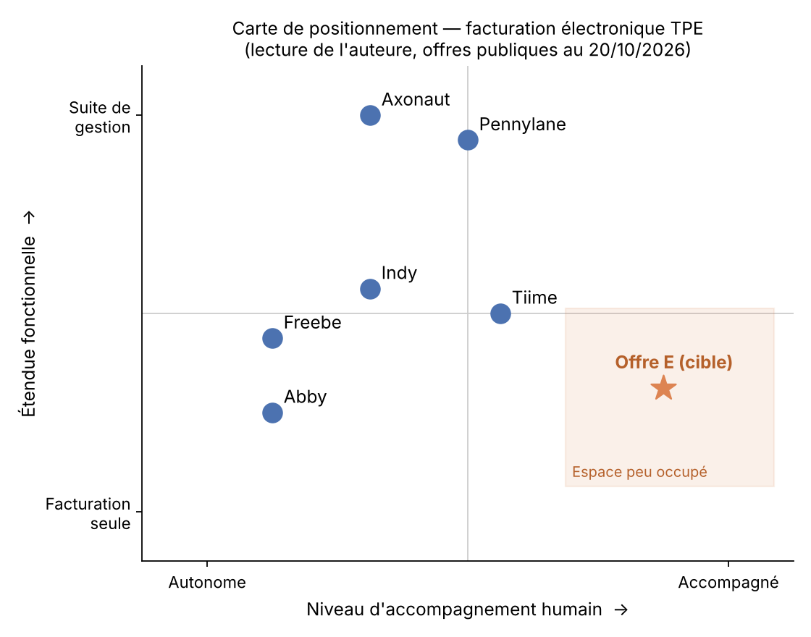

# Lancer une offre de facturation électronique pour les TPE : de la voix du client au go-to-market

> Étude de cas de product marketing : à partir d'une enquête publique auprès de 4 671 dirigeants de TPE-PME, construire le lancement d'une offre fictive de facturation électronique, **Duo Facture**, face à la réforme 2026-2027 : segments, personas, positionnement, battlecard, pricing et plan de lancement.

**Compétences mobilisées :** analyse de la voix du client, segmentation, dimensionnement de marché, analyse concurrentielle, positionnement et messaging, sales enablement, pricing et packaging, plan go-to-market
**Outils :** Python (pandas, matplotlib) pour l'analyse, Markdown pour les livrables

---

## 1. Contexte

Toutes les entreprises assujetties à la TVA doivent pouvoir **recevoir** des factures électroniques depuis le 1er septembre 2026, et les PME et micro-entreprises devront les **émettre** à partir du 1er septembre 2027. Des centaines de milliers de TPE doivent s'équiper en moins d'un an.

La question posée est celle d'un éditeur qui voudrait entrer sur ce marché : **qui cibler, avec quelle promesse, à quel prix et par quels canaux ?**

## 2. Les données

| Source | Utilisation | Licence |
|---|---|---|
| [Baromètre France Num 2022](https://www.data.gouv.fr/datasets/france-num-barometre-2022-libelles-des-questions-et-resultats-1) (DGE, enquête CREDOC) : 4 671 dirigeants, réponses individuelles pondérées | Voix du client, segmentation, personas, budgets | Licence Ouverte 2.0 |
| [Insee, Ésane, entreprises par catégorie, 2023](https://www.insee.fr/fr/statistiques/2016091) | Dimensionnement du marché | Licence Ouverte 2.0 |
| Pages tarifaires publiques de six éditeurs, relevées le 20/10/2026 | Paysage concurrentiel, pricing, battlecard | Informations publiques, sources citées |

## 3. Les principaux résultats

### Trois segments, trois personas

| Persona | Segment | Part des TPE-PME | Ce qui le caractérise |
|---|---|---|---|
| **Karim**, commerce de 4 salariés | Déjà équipé d'un outil de facturation | 69,5 % | Doute de la conformité de son outil ; 24 % des équipés n'émettent encore aucune facture électronique |
| **Sophie**, cabinet de services | Non équipée, prête à investir | 14,8 % | Convaincue par le numérique (81 %), suit les recommandations de ses pairs (40 %) |
| **Jean-Marc**, exploitation agricole de 2 salariés | Non équipé, budget serré | 15,7 % | 52 % sans aucun budget numérique, 49 % sans compétences ni projet, écoute son comptable deux fois plus que les autres |

### Le marché

- **TAM** : 5,0 millions de microentreprises et PME.
- **SAM** : 1,53 million d'entreprises sans solution de facturation.
- **SOM à trois ans** (scénario central) : environ 37 500 clients et 2,1 M€ de revenu récurrent annuel.

### La concurrence

La conformité de base est devenue **gratuite** : au moins 13 plateformes agréées la proposent sans frais. Elles visent toutes des utilisateurs autonomes, et l'accompagnement humain coûte au moins 63 € par mois. **L'espace « simple et accompagné » est peu occupé**, alors qu'il correspond au segment de Jean-Marc.



### La stratégie retenue

- **Positionnement** : la facturation électronique la plus simple du marché, mise en place avec une personne et suivie par le comptable du client. Signature : *« La facture électronique, sans vous débrouiller seul. »*
- **Pricing** : Découverte gratuite (avec séance de mise en route et accès comptable), Essentiel à 9 € HT par mois, Accompagné à 19 € HT par mois.
- **Canal prioritaire** : les cabinets d'expertise comptable, rémunérés par client payant recommandé.
- **Point de vigilance** : au lancement, un client payant met 29 mois à rentabiliser son coût d'acquisition. L'objectif est de passer sous 12 mois en développant le canal des cabinets.

## 4. Les livrables

| # | Livrable | Fichier |
|---|---|---|
| 1 | Note de cadrage | [`docs/brief_cadrage.md`](docs/brief_cadrage.md) |
| 2 | Analyse de la voix du client et segmentation | [`notebooks/01_voix_du_client.ipynb`](notebooks/01_voix_du_client.ipynb) |
| 3 | Dimensionnement du marché (TAM, SAM, SOM) | [`notebooks/02_dimensionnement_marche.ipynb`](notebooks/02_dimensionnement_marche.ipynb) |
| 4 | Trois personas fondées sur les données | [`docs/personas.md`](docs/personas.md) |
| 5 | Paysage concurrentiel et carte de positionnement | [`docs/paysage_concurrentiel.md`](docs/paysage_concurrentiel.md) |
| 6 | Positionnement, nom et messaging house | [`docs/positionnement_messaging.md`](docs/positionnement_messaging.md) |
| 7 | Battlecard face à Indy | [`docs/battlecard_indy.md`](docs/battlecard_indy.md) |
| 8 | Pricing et packaging | [`docs/pricing_packaging.md`](docs/pricing_packaging.md) |
| 9 | Plan de lancement à 90 jours, budget et KPI | [`docs/plan_lancement_90j.md`](docs/plan_lancement_90j.md) |

## 5. Méthode

1. **Écouter le marché** : recodage des réponses du baromètre en indicateurs, pondération pour représenter les TPE-PME françaises, comparaison des entreprises équipées et non équipées.
2. **Segmenter** : segmentation par règles, sur l'équipement et le budget, pour obtenir des groupes simples à expliquer à une équipe commerciale.
3. **Dimensionner** : application des parts de segments aux effectifs de l'Insee, avec des hypothèses de conquête explicites.
4. **Analyser la concurrence** : relevé des offres publiques, construction d'une carte de positionnement, identification d'un espace peu occupé.
5. **Construire l'offre** : positionnement, messages par persona, battlecard, grille de prix justifiée par les budgets déclarés et les prix du marché.
6. **Planifier le lancement** : calendrier, canaux, budget, indicateurs, équation économique et risques.

Chaque document distingue les **données mesurées** des **hypothèses**, et propose la manière de valider ces dernières (entretiens, tests A/B, test de prix).

## 6. Limites

- Le baromètre date de 2022, avant l'entrée en vigueur de la réforme : il décrit le point de départ des entreprises, pas leur situation actuelle.
- Duo Facture est une offre fictive. Les éléments de crédibilité (plateforme agréée, certification, partenariats) sont des conditions de lancement, pas des faits.
- Les prix des concurrents sont ceux de leurs pages publiques au 20 octobre 2026 et peuvent avoir changé.
- Les positions sur la carte concurrentielle relèvent de l'analyse de l'auteure.

## 7. Reproduire l'analyse

```bash
git clone https://github.com/niyadanielleO/smb-e-invoicing-go-to-market.git
cd smb-e-invoicing-go-to-market
conda activate segmentation
```

Télécharger `bfn-resultats-2022.csv` sur [data.gouv.fr](https://www.data.gouv.fr/datasets/france-num-barometre-2022-libelles-des-questions-et-resultats-1), le placer dans `data/`, puis exécuter les deux notebooks dans l'ordre.

---

**N. Danielle OUATTARA** · [LinkedIn](https://www.linkedin.com/in/ndanielleouattara/) · [Mes autres projets](https://github.com/niyadanielleO)
